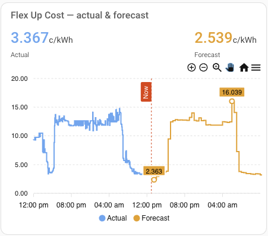

# Localvolts

A Home Assistant integration for customers of [Localvolts](https://localvolts.com), the Australian electricity retailer.

[](https://my.home-assistant.io/redirect/hacs_repository/?owner=gurrier&repository=localvolts&category=integration)

It tells you what a kilowatt-hour costs you *right now*, what you'd earn exporting one, what it will cost over the next 24 hours, and - on a demand tariff - what one more kilowatt would add to your demand charge. Everything updates every 5 minutes, so your automations can decide when to run appliances, charge or discharge a battery, or export to the grid.

☕ If it's useful to you, [buy me a coffee](https://ko-fi.com/gurrier).

---

## Install

1. Click the badge above, or open HACS → Integrations, search for **Localvolts**, and download it.
2. Restart Home Assistant.
3. Go to **Settings → Devices & Services → Add Integration**, search for Localvolts, and enter your **API key** and **Partner ID**. Both are on the Localvolts website under **My Profile → API Key** (request one at https://localvolts.com/localvolts-api/ if it isn't there).

That's all you type. The integration asks Localvolts which sites (NMIs) are on your account: one site is selected for you, several gives you a list. To add another site, add the integration again. To change credentials later, use the cog on the integration.

To check it worked, open **Settings → Devices & Services → Localvolts** and click the device. You should see prices within a minute.

## What you get

One device per site, named `Localvolts <NMI>`, showing your network and tariff as its model. On it:

| Sensor | What it is | Unit |
|---|---|---|
| **costsFlexUp** | What one more kWh imported costs you, for the current 5-minute interval - including network fees and loss factors | $/kWh |
| **earningsFlexUp** | What one more kWh exported earns you, for the current interval | $/kWh |
| **Forecasted Costs Flex Up** | The import price for the *next* interval, with the full 24-hour forecast as its `forecast` attribute | c/kWh |
| **Demand flex up** | What one more kW of demand would add to your demand charge right now. 0 when no demand charge applies | as billed, e.g. c/kW |
| **IntervalEnd** | When the current interval ends, with every field Localvolts publish for it as attributes | timestamp |
| **DataLag** | How long after the interval started Localvolts published its price - typically 15-25 s | s |
| **Import tariff**, **Export tariff**, **Network**, **Site** | What Localvolts know about your site: tariff codes, your distributor, your region, and more as attributes of Site | diagnostic |

Entity IDs depend on when you installed: long-standing installations have `sensor.costsflexup` and so on, while recent Home Assistant versions give new entities IDs like `sensor.localvolts_<nmi>_costsflexup`. Your IDs are on the device page - substitute them in the examples below. [Details](docs/details.md#entity-ids).

## Using the prices

Three things to know, and you can skip the rest of this page.

**Unavailable means "don't act".** A price belongs to one 5-minute interval, and the next can be very different, so the sensors go `unavailable` 90 seconds after an interval ends without a fresh price rather than show a stale one. It's brief and rare. Gate automations on `{{ has_value('sensor.costsflexup') }}` instead of substituting a number. If it lasts more than five minutes the log says why - [what the message means](docs/details.md#when-prices-stop-arriving).

**Prices are in $/kWh; the forecast is in c/kWh.** Comparing them in a template needs a factor of 100: `forecast / 100 < current`. The forecast keeps the API's unit because changing it would break every automation already reading it.

**Demand flex is a cost per kW, not per kWh.** On a demand tariff you pay for the month's peak average demand inside a demand window. `Demand flex up` is Localvolts' estimate of what one more kW now would add to that charge: 0 outside the window or in a month the tariff doesn't track, rising as the month's peak comes within reach. Zero is a real reading. The peak it works from is as settled so far - your meter data reaches Localvolts the next morning - so treat it as the running target to stay under. To compare it with the energy price, the two combine as `costsFlexUp + 0.12 × flexDemandUp` in $/kWh for a single interval - [why, and a template](docs/examples.md#the-true-cost-of-one-more-kilowatt). On a tariff with no demand component it stays at 0.

## Keeping the record straight

**Gaps in your statistics are repaired.** If a price arrives late - Home Assistant restarting, your network dropping, a Localvolts stall - Home Assistant's hourly statistic for that hour is built from a carried-forward price and looks fine when it isn't. Localvolts keep 72 hours of history, so the integration checks its own history on startup and hourly, and rewrites any hour that received fewer than twelve intervals from the real published prices. Only the two price sensors' long-term statistics are touched; the History graph still shows the gap as it happened; nothing is ever invented. [How it decides](docs/details.md#filling-gaps-in-the-statistics).

## Examples

- [Knowing when a demand window is open](docs/examples.md#knowing-when-a-demand-window-is-open)
- [The true cost of one more kilowatt](docs/examples.md#the-true-cost-of-one-more-kilowatt)
- [Being told when prices stop arriving](docs/examples.md#being-told-when-prices-stop-arriving)
- [Highest cost and earnings in the next 24 hours](docs/examples.md#highest-cost-and-earnings-in-the-next-24-hours)

### Charting settled prices alongside the forecast



With the [ApexCharts Card](https://github.com/RomRider/apexcharts-card) (in HACS) you can plot the price you actually paid alongside the forecast on one chart - the last 24 hours left of a "now" marker, the next 24 to the right.

```yaml
type: custom:apexcharts-card
header:
  show: true
  title: Flex Up Cost — actual & forecast
  show_states: true
  colorize_states: true
graph_span: 48h
span:
  start: hour
  offset: -24h
now:
  show: true
  label: Now
  color: red
apex_config:
  chart:
    zoom:
      enabled: true
      type: x
      autoScaleYaxis: true
    toolbar:
      show: true
      autoSelected: pan
      tools:
        zoom: true
        zoomin: true
        zoomout: true
        pan: true
        reset: true
  stroke:
    dashArray:
      - 0
      - 6
  legend:
    show: true
  yaxis:
    decimalsInFloat: 2
series:
  # Settled price, from the raw attribute: full precision and already c/kWh.
  - entity: sensor.intervalend
    attribute: costsFlexUp
    name: Actual
    type: line
    curve: stepline
    unit: c/kWh
    color: '#03a9f4'
    stroke_width: 2
    extend_to: now
    float_precision: 3
    show:
      legend_value: false
  - entity: sensor.forecasted_costs_flex_up
    name: Forecast
    type: line
    curve: stepline
    unit: c/kWh
    color: '#ff9800'
    stroke_width: 2
    extend_to: false
    float_precision: 3
    show:
      in_header: after_now
      legend_value: false
      extremas: true
    data_generator: |
      return (entity.attributes.forecast || []).map((f) => {
        return [new Date(f.start_time).getTime(), Number(f.costsFlexUp)];
      });
```

Three things that matter in that config: don't add `update_interval` (the card then redraws on its own timer and the header lags the real price); keep the `|| []` (when the sensor is unavailable its attributes vanish, and without the fallback the card errors instead of drawing an empty line); and the "Actual" series reads the raw `costsFlexUp` attribute of `sensor.intervalend` because it is in c/kWh like the forecast, where `sensor.costsflexup` is $/kWh rounded to three places.

### Feeding forecasts into EMHASS

[EMHASS](https://github.com/davidusb-geek/emhass) accepts price forecasts as a `{timestamp: price}` dict through its `load_cost_forecast` (import) and `prod_price_forecast` (export) parameters ([docs](https://emhass.readthedocs.io/en/latest/forecasts.html)). Everything it needs is in the `forecast` attribute; this template reshapes it. Adjust the `/ 100` to whatever unit your EMHASS is configured in.

```yaml
template:
  - sensor:
      - name: "EMHASS Price Forecasts"
        unique_id: "emhass_price_forecasts"
        state: "ok"
        attributes:
          load_cost_forecast: >
            
            
              
            
            {{ ns.cost }}
          prod_price_forecast: >
            
            
              
            
            {{ ns.price }}
```

## Removing

Settings → Devices & Services → Localvolts → three dots → **Delete**, then in HACS → Localvolts → **Remove**, then restart. Re-adding within 30 days brings back the same entity IDs and history; after that, Home Assistant generates new IDs ([details](docs/details.md#entity-ids)).

---

More depth, when you want it: [docs/details.md](docs/details.md) covers the full forecast record, the outage log message, entity IDs and history, and exactly how the statistics repair decides what to rewrite.
